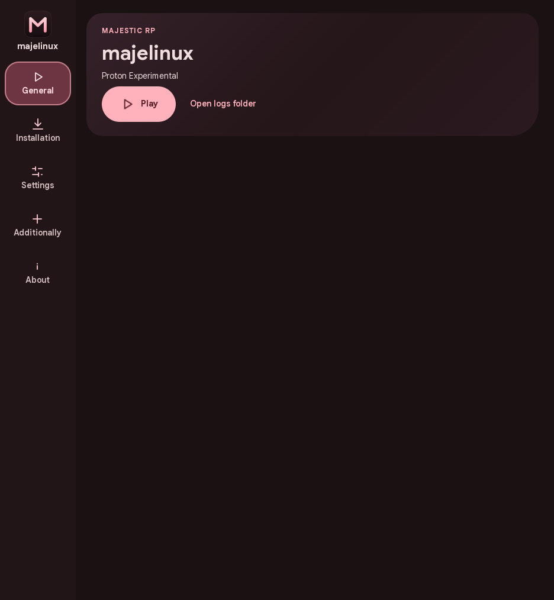
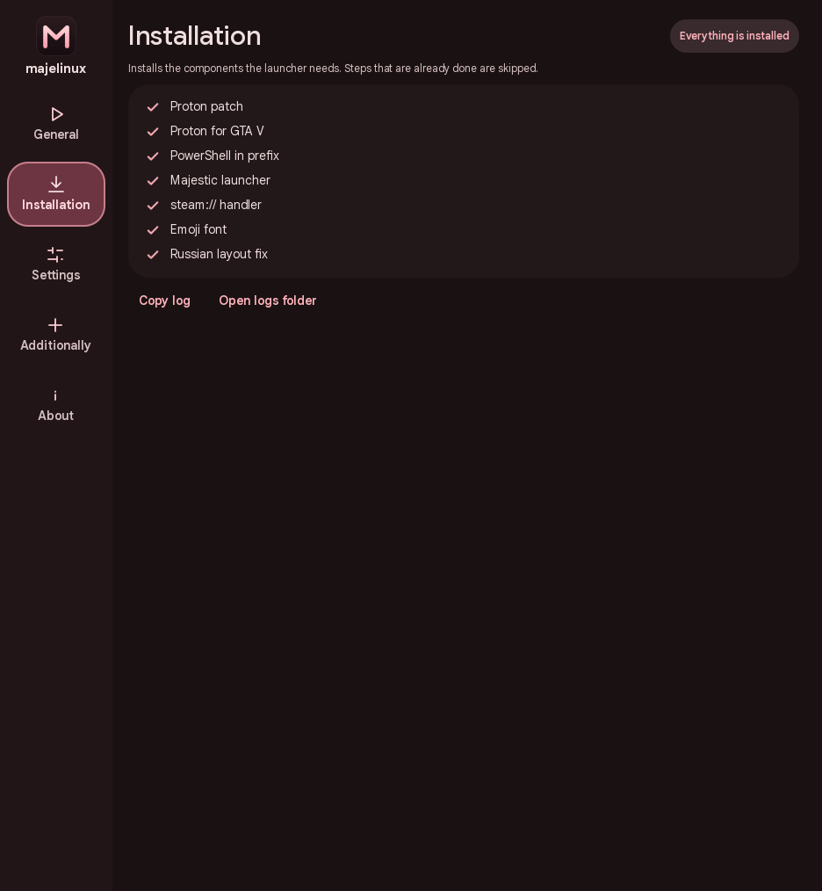
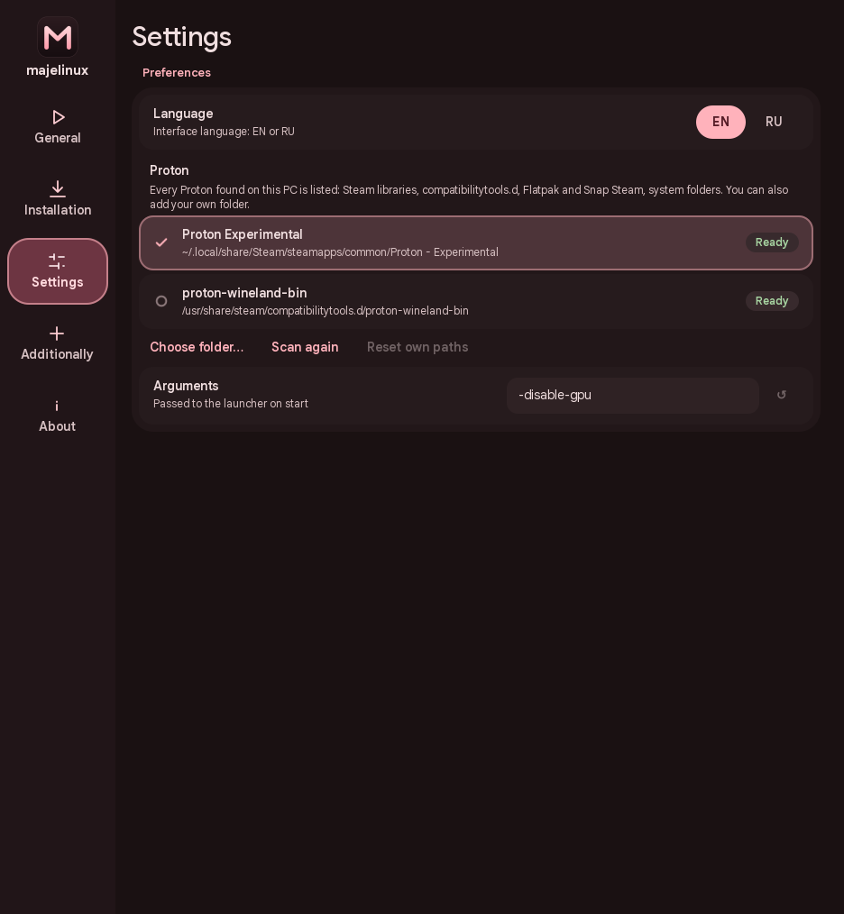

# majelinux

**Native Linux launcher for Majestic RP on Grand Theft Auto V.**

[English](README.md) · [Русский](README.ru.md)

[](LICENSE)
[](#requirements)
[](https://www.rust-lang.org/)
[](https://github.com/redyabigboss/majelinux/commits/main)
[](https://github.com/redyabigboss/majelinux/releases)

---

## About

majelinux is a small, native Linux front-end for the Windows Majestic RP launcher. It prepares the Grand Theft Auto V Proton prefix, installs the components the original launcher needs, applies a narrow Wine compatibility patch to the selected Proton build, and starts the original `Majestic Launcher.exe` inside the GTA V compatibility environment.

The program is written in Rust and draws its GTK 3 interface through direct FFI calls. It has no third-party Rust dependencies and ships as a single ELF binary.

What it does:

- Detects Proton builds in Steam libraries, `compatibilitytools.d`, Flatpak Steam, Snap Steam and system folders, and accepts custom Proton folders.
- Installs the original Majestic Launcher, PowerShell, the `steam://` handler, an emoji font and a Russian keyboard-layout fix inside the GTA V prefix.
- Applies an in-place `ntdll.so` compatibility patch to the selected Proton build only when the expected code sequence is present. The original file is backed up first.
- Writes the Steam compatibility-tool mapping for app `271590`, adds `PROTON_ENABLE_WAYLAND=0` to the Steam launch options when it is missing, and starts Steam when needed.
- Launches the original launcher through `protontricks-launch` with the correct Steam compatibility environment.
- Keeps the interface on the current page while Proton is being changed.
- Supports English and Russian, live installation logs, a debug window, and an update checker with SHA-256 verification.
- Can suspend the original Majestic Launcher after the game has been running for a while, reducing CPU and GPU load without terminating the Wine session.

The GTA V game files are not modified.

## Screenshots

<p align="center">
  
  
</p>

<p align="center">
  
</p>

## Compatibility

> [!IMPORTANT]
> Only **Steam** Grand Theft Auto V **Legacy** with **Proton Experimental** is officially supported. Other configurations may work, but they have not been validated and are not covered by support.

| Component | Status | Notes |
| --- | :---: | --- |
| Grand Theft Auto V — Steam, Legacy edition | ✅ Supported | App ID `271590` |
| Grand Theft Auto V — Enhanced edition | ❌ Not supported | Different executable and compatibility requirements |
| Grand Theft Auto V — Rockstar Games Launcher | ❌ Not supported | The launcher expects the Steam prefix layout |
| Grand Theft Auto V — Epic Games Store | ❌ Not supported | The launcher expects the Steam prefix layout |
| Proton Experimental | ✅ Supported | The recommended and tested build |
| Other Proton versions (stable branches, GE-Proton, custom builds) | ⚠️ Needs testing | Detection works, stability is not guaranteed |
| Linux x86_64, X11 or Wayland session | ✅ Supported | The Windows launcher runs through Proton |
| Windows, macOS | ❌ Not supported | Linux-only |

The Proton selector can list other builds because users may want to experiment. Listing a build is not a compatibility promise.

## Required Steam launch option

Set this launch option for Grand Theft Auto V in Steam:

```text
PROTON_ENABLE_WAYLAND=0 %command%
```

How to set it:

1. Open Steam.
2. Go to **Library**.
3. Right-click **Grand Theft Auto V** and choose **Properties**.
4. Open **General**.
5. Find **Launch Options**.
6. Paste `PROTON_ENABLE_WAYLAND=0 %command%` and close the window.

If other options are already present, keep them and put the variable before them:

```text
PROTON_ENABLE_WAYLAND=0 DXVK_HUD=1 %command%
```

Without `PROTON_ENABLE_WAYLAND=0`, the Wine/Proton Wayland driver can make the original launcher unstable or prevent it from starting. majelinux also adds this variable automatically to `localconfig.vdf` when it is missing, and exports it in the environment used by **Play**, but the Steam launch option above remains the recommended setup because Steam and other tools read it directly.

## Requirements

| Requirement | Details |
| --- | --- |
| OS | Linux x86_64 |
| Desktop | X11 or Wayland session with GTK 3 |
| Steam | Native, Flatpak or Snap installation |
| Game | Steam Grand Theft Auto V Legacy, installed and started at least once |
| Proton | Proton Experimental installed in Steam |
| Runtime | `protontricks`, GTK 3 |
| Build helper | `gcc` for the Russian layout shim |
| Downloads | `curl` or `wget` |
| Optional | `xdg-open` for opening the log folder |
| Build | Rust 1.85 or newer (edition 2024), Cargo |

The first **Play** or **Install** run checks for `protontricks` and `gcc`. If a package is missing, the interface shows the package-manager command for `pacman`, `apt`, `dnf`, `zypper` or `xbps-install`; installation continues automatically after the packages appear.

## Installation

### Prebuilt binary

Download the latest binary and its checksum:

```bash
curl -LO https://github.com/redyabigboss/majelinux/releases/latest/download/majelinux-linux-x86_64
curl -LO https://github.com/redyabigboss/majelinux/releases/latest/download/SHA256SUMS
sha256sum -c SHA256SUMS --ignore-missing
chmod +x majelinux-linux-x86_64
./majelinux-linux-x86_64
```

To keep the binary in `PATH`:

```bash
install -Dm755 majelinux-linux-x86_64 "$HOME/.local/bin/majelinux"
```

### From source

Install the build dependencies for your distribution. On Arch Linux:

```bash
sudo pacman -S --needed rust gtk3 protontricks gcc curl
```

On Debian or Ubuntu, install GTK 3 development files, `protontricks`, `gcc` and `curl`; use [rustup](https://rustup.rs/) if the distribution Rust is older than 1.85.

Build and install:

```bash
git clone https://github.com/redyabigboss/majelinux.git
cd majelinux
cargo build --release
./packaging/install.sh
```

`packaging/install.sh` installs the binary to `~/.local/bin/majelinux`, the desktop entry to `~/.local/share/applications/majelinux.desktop`, and the icons to the hicolor theme. To remove these files:

```bash
./packaging/uninstall.sh
```

The uninstall script does not delete user configuration, logs, Proton backups or the GTA V prefix.

### First run

1. Start Steam and make sure Grand Theft Auto V Legacy and Proton Experimental are installed.
2. Start majelinux from the application menu or run `majelinux`.
3. Open **Installation** and press **Install**, or press **Play** on the first page. **Play** starts the installation automatically when something is missing.
4. Select the Proton build in **Settings** if the default one is not the build you want.
5. When installation finishes, press **Play**.

Changing the Proton mapping requires Steam to be closed. majelinux closes Steam, writes the mapping and starts Steam again.

## Usage

### Interface

| Page | Purpose |
| --- | --- |
| **General** | Starts the game, shows the current state, and opens the log folder |
| **Installation** | Runs the seven installation steps, shows package requirements and live logs |
| **Settings** | Interface language, Proton selection, custom Proton folders, launcher arguments |
| **Additionally** | Debug mode with a live log window |
| **About** | Version, project link, license and update checker |

### Installation steps

| Step | What it does |
| --- | --- |
| Proton patch | Applies the `ntdll.so` compatibility fix to the selected Proton build |
| Proton for GTA V | Writes the compatibility-tool mapping for app `271590` into Steam `config.vdf` |
| PowerShell in prefix | Installs PowerShell into the GTA V prefix with `protontricks` |
| Majestic launcher | Downloads and runs `MajesticLauncherSetup.exe` inside the prefix |
| steam:// handler | Creates `C:\majestic\steam-run.bat` and registers the `steam://` URL handler |
| Emoji font | Installs a renamed Twemoji font as `seguiemj.ttf` (optional) |
| Russian layout fix | Builds `nolcall.so`, which removes `LC_ALL=C` from the launcher environment |

### Launcher arguments

The **Arguments** field is passed to `Majestic Launcher.exe`. The default is:

```text
-disable-gpu
```

The reset button restores the default. Additional arguments for `protontricks-launch` can be set with `protontricks_args` in the configuration file.

### Launcher cleanup

After GTA V has been running for the configured delay, majelinux can reduce the resources used by the original Majestic Launcher. The default is `suspend` after 60 seconds.

| Mode | Behaviour |
| --- | --- |
| `suspend` | Sends `SIGSTOP` to all Majestic Launcher processes, hides their windows, and resumes them if the game returns. After the game exits, the launcher is terminated with `SIGTERM`, then `SIGKILL` after two seconds. This is the default and the safest mode. |
| `renderers` | Repeatedly terminates Majestic Launcher CEF renderer processes while the game runs. |
| `all` | Terminates all Majestic Launcher processes after the delay. This can end the Wine session and disconnect the game. A guard file disables this mode after a detected failure. |
| `off` | No cleanup. |

The settings are stored in `~/.config/majelinux/config.ini`:

```ini
[General]
extra_args=-disable-gpu
proton=
language=en
debug=false
launcher_trim=suspend
launcher_trim_delay=60
protontricks_args=
```

`proton` is empty for the automatically selected build, or `path:/absolute/path` for a custom build. `custom_proton` lines add custom Proton folders.

### Command line

```text
majelinux --version
majelinux --trim-launcher <off|renderers|all|suspend> <delay-seconds>
majelinux --wait-pid <pid>
```

`--trim-launcher` is used internally by the launcher cleanup process. `--wait-pid` is used by the self-updater to wait for the old process to exit before starting the new binary.

### Environment

| Variable | Effect |
| --- | --- |
| `MAJELINUX_NO_SELF_UPDATE` | Disables the built-in updater when set to a non-empty value other than `0` |
| `XDG_CONFIG_HOME` | Changes the configuration directory |
| `XDG_STATE_HOME` | Changes the state and log directory |
| `XDG_CACHE_HOME` | Changes the download cache directory |

### Files and directories

| Path | Contents |
| --- | --- |
| `~/.config/majelinux/config.ini` | User settings |
| `~/.local/state/majelinux/` | State, lock file, update staging, Proton backups |
| `~/.local/state/majelinux/logs/` | Installation, launch, debug and trim logs |
| `~/.local/state/majelinux/proton-backup/` | Backups of patched `ntdll.so` files |
| `~/.cache/majelinux/` | Downloaded installer and emoji font |
| `steamapps/compatdata/271590/pfx` | GTA V Proton prefix |
| `steamapps/common/Grand Theft Auto V` | GTA V game directory |

`XDG_CONFIG_HOME`, `XDG_STATE_HOME` and `XDG_CACHE_HOME` replace the corresponding `~/.config`, `~/.local/state` and `~/.cache` prefixes.

## How it works

### Launch flow

1. Load settings and migrate the old state directory when needed.
2. Check that the original launcher exists in the GTA V prefix.
3. Check for `protontricks` and `gcc`, and wait for the user to install missing packages.
4. Ensure Steam is running.
5. Prepare the GTA V prefix for the selected Proton build when its `config_info` does not match.
6. Add `PROTON_ENABLE_WAYLAND=0` to the Steam launch options for app `271590` when missing.
7. Apply the Proton `ntdll.so` patch when the exact compatible sequence is present.
8. Run a pending Majestic Launcher update if one is waiting in the prefix.
9. Create the `S:` drive link to the Steam library.
10. Start the launcher with `protontricks-launch --appid 271590 <launcher> <arguments>`, using the GTA V compatibility data path, Steam client path and app IDs.
11. Start the launcher cleanup watcher after the game process appears.
12. Watch new Wine processes in the debug log, tail the launcher log, and keep the interface responsive.

The original launcher is not replaced. majelinux starts it inside the same Proton prefix that Steam uses for GTA V, so the game, the launcher and the Majestic RP client share one Wine environment.

### Project structure

```text
majelinux/
├── Cargo.toml                  Rust package and release profile
├── Cargo.lock                  Locked dependency graph (no third-party crates)
├── LICENSE                     MIT license
├── README.md                   English documentation
├── README.ru.md                Russian documentation
├── assets/
│   ├── icon.png                Application icon
│   ├── icon.svg                Scalable application icon
│   └── fonts/
│       ├── GoogleSans.ttf      Bundled interface font
│       └── OFL.md              Font license
├── packaging/
│   ├── install.sh              User-level installation
│   ├── uninstall.sh            User-level removal
│   ├── release.sh              Reproducible release archive and checksums
│   └── majelinux.desktop       Desktop entry
└── src/
    ├── main.rs                 Entry point and command-line dispatch
    ├── ffi.rs                  GTK 3, GLib, GObject, Cairo and libc bindings
    ├── i18n.rs                 English and Russian strings
    ├── ui/
    │   ├── mod.rs              Window, pages, state, callbacks, update UI
    │   ├── widgets.rs          Widget helpers and symbolic icons
    │   └── css.rs              GTK CSS theme
    └── core/
        ├── diag.rs             Wine process diagnostics
        ├── font.rs             TrueType name-table rewriting
        ├── install.rs          Prefix installation steps
        ├── launch.rs           Launch orchestration
        ├── launchopts.rs       Steam launch-option writer
        ├── log.rs              Buffered logging and log tailing
        ├── net.rs              Download helpers
        ├── paths.rs            XDG and Steam paths
        ├── process.rs          Process, signal and /proc helpers
        ├── proton.rs           Proton discovery and ntdll patching
        ├── settings.rs         INI settings
        ├── sha256.rs           SHA-256 implementation
        ├── steam.rs            Steam library discovery
        ├── trim.rs             Launcher cleanup watcher
        ├── update.rs           Self-update pipeline
        ├── util.rs             Shell splitting and small helpers
        └── vdf.rs              Valve Data Format parser and writer
```

### Proton patch

The patch targets a single instruction sequence in `ntdll.so`. It restores the Windows `RCX` register when a syscall returns, which the original launcher expects from Wine. majelinux:

- reads the selected Proton build;
- counts the exact sequence;
- applies the patch only when it occurs exactly once;
- writes the result atomically;
- verifies the patched file;
- stores the original `ntdll.so` under the state directory.

Builds where Wine already restores `RCX` are used without changes. Builds without the expected sequence are also used as-is. A read-only Proton directory is never modified. The game files are not touched.

### Self-update

On startup, majelinux asks the GitHub Releases API for the latest release of `redyabigboss/majelinux`. When a newer version exists, the updater:

1. downloads `SHA256SUMS` and `majelinux-linux-x86_64`;
2. verifies the SHA-256 checksum;
3. checks that the file is an ELF binary and that it runs with `--version`;
4. copies it next to the current executable, keeps the previous binary in the state directory, and atomically replaces the executable;
5. starts the new binary with `--wait-pid <old-pid>` and exits.

Package-managed installations under `/usr`, `/nix/store` or `/app` refuse self-update and must be updated by the package manager.

### Logs

Every launch creates a timestamped log in `~/.local/state/majelinux/logs/`. The Installation and Debug pages show the live log. Old logs are cleaned up on startup. The launcher cleanup writes its decisions to `trim.log`.

## Troubleshooting

| Problem | Solution |
| --- | --- |
| `No graphical session found` | Start majelinux inside a desktop session with a valid `DISPLAY` or `WAYLAND_DISPLAY`. |
| `majelinux is already running` | Close the other instance. The lock is released automatically when the process exits. |
| `GTA V not found` | Install the Steam Legacy edition and start it once from Steam. |
| `Prefix 271590 not found` | Start GTA V once from Steam so the Proton prefix is created. |
| `Launcher not found in the prefix` | Run **Installation** again and complete the **Majestic launcher** step. |
| `Steam did not close` | Close Steam manually and press **Play** again. The compatibility mapping is written only while Steam is stopped. |
| `Pattern found N times ... nothing was changed` | The selected Proton build is not compatible with the patch. Use Proton Experimental. |
| `The release has no checksum for this build` | The release is incomplete or the network returned an HTML page. Retry later. |
| `The downloaded file does not match its checksum` | Delete `~/.local/state/majelinux/update/` and try again. |
| `majelinux is installed by a package manager` | Update the package with your package manager instead of the built-in updater. |
| Launcher or game crashes on start | Set `PROTON_ENABLE_WAYLAND=0 %command%`, select Proton Experimental, and inspect the latest log. |
| No game window after **Play** | Check the launch log, make sure the original launcher is installed, and verify that the `steam://` handler step is complete. |
| Emoji are missing in the launcher | The emoji step is optional; rerun it from **Installation**. |
| Launcher stays on screen during the game | Check `~/.local/state/majelinux/logs/trim.log`; the default delay is 60 seconds and the mode is `suspend`. |
| Update check fails on startup | Automatic checks fail silently; open **About** and run a manual check to see the error. |

For a detailed log, enable **Debug mode** on the **Additionally** page. The debug window keeps the full output visible and stops the prefix when you close it.

## FAQ

**Does majelinux modify GTA V?**
No. It works with the Proton prefix, the selected Proton build, Steam configuration and the original Majestic Launcher. Game files are not modified.

**Does it work with GTA V Enhanced?**
No. Only the Legacy edition is supported.

**Does it work with the Rockstar Games Launcher or Epic Games Store version?**
No. The launcher expects the Steam prefix and Steam app ID `271590`.

**Does it download GTA V?**
No. GTA V must be installed and owned on Steam.

**Can I use GE-Proton or another Proton build?**
The selector can detect and try other builds, but only Proton Experimental is officially supported. Treat other builds as experimental.

**Why does changing Proton close Steam?**
Steam keeps `config.vdf` open and may overwrite changes. majelinux closes Steam, writes the compatibility mapping, verifies it, and starts Steam again.

**Why is the original launcher suspended instead of closed?**
Closing the launcher can tear down the Wine session and disconnect the game. Suspension stops CPU and GPU work while keeping the session alive. After the game exits, the launcher is terminated and the resources are released.

**Is there a CLI-only mode?**
No. The program requires a graphical session. The command-line flags are limited to version output and internal helper modes.

**How do I uninstall?**
Run `./packaging/uninstall.sh`, then remove `~/.config/majelinux`, `~/.local/state/majelinux` and `~/.cache/majelinux` if you also want to delete settings, logs and cached downloads.

## Contributing

Issues and pull requests are welcome. Before submitting a change:

```bash
cargo fmt --check
cargo test --release
cargo build --release
```

Keep the project free of third-party Rust crates, keep the GTK 3 interface working on both X11 and Wayland, and do not add code that modifies GTA V game files. Describe the tested Proton build and distribution in the pull request.

## License

[MIT](LICENSE) © 2026 Qustsu

The bundled Google Sans font is distributed under the SIL Open Font License; see [`assets/fonts/OFL.md`](assets/fonts/OFL.md). The emoji font downloaded at runtime is based on Twemoji (CC-BY 4.0) and Mozilla `twemoji-colr` (Apache License 2.0).

## Disclaimer

majelinux is an unofficial community project. It is not affiliated with Rockstar Games, Take-Two Interactive, Valve Corporation, Majestic RP or the Majestic Launcher developers. Grand Theft Auto V, Rockstar Games, Take-Two, Steam, Proton and Majestic RP are trademarks of their respective owners. A legally purchased copy of Grand Theft Auto V is required.

Use the software at your own risk. The authors are not responsible for bans, data loss, account restrictions or damage caused by third-party software or server rules.
