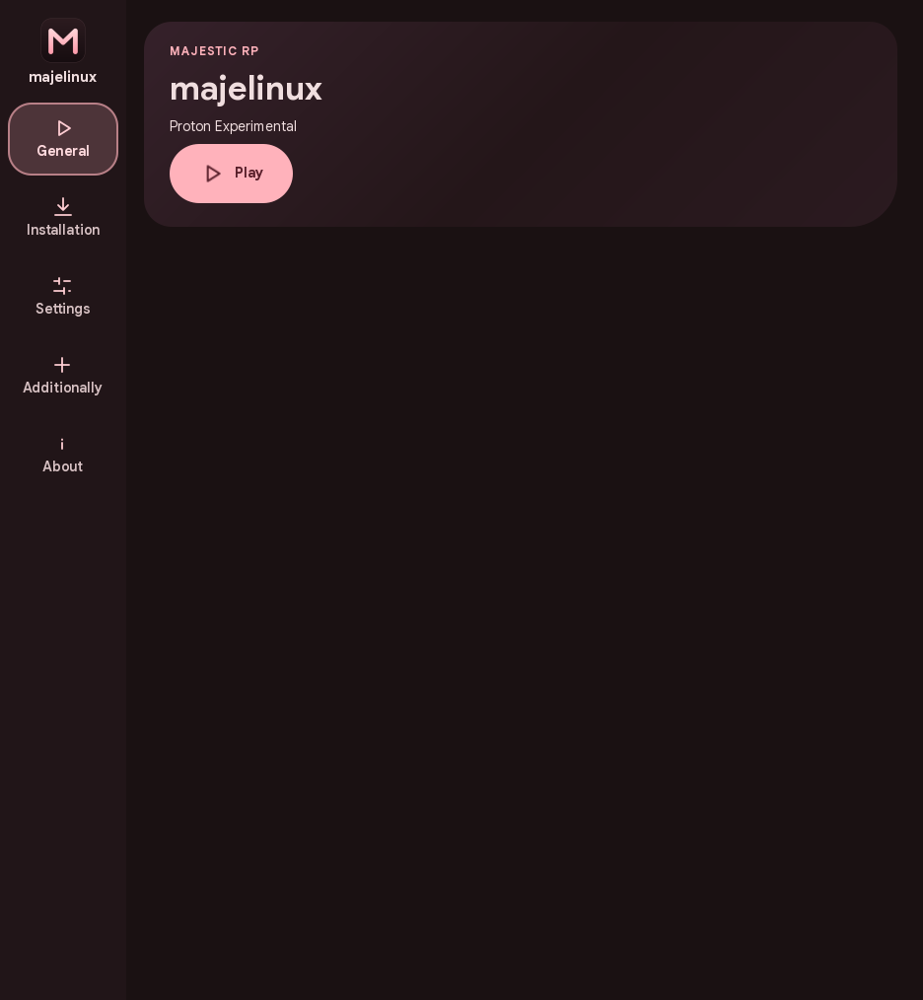
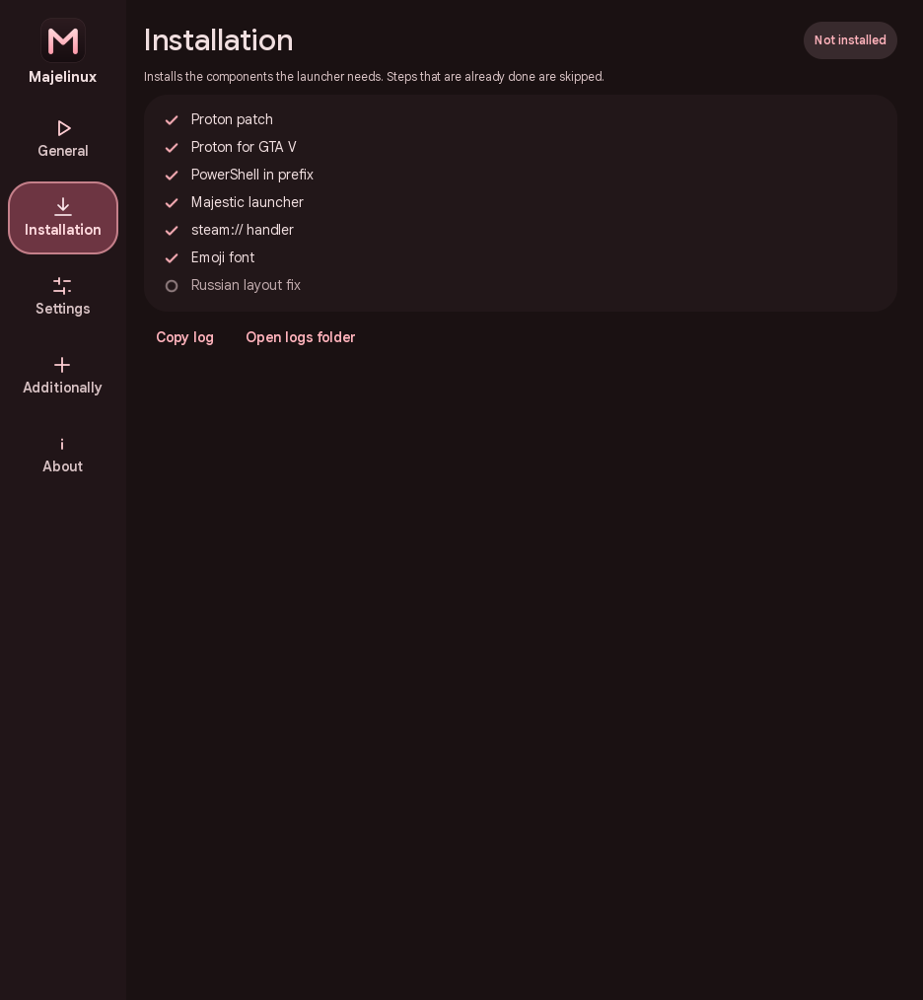
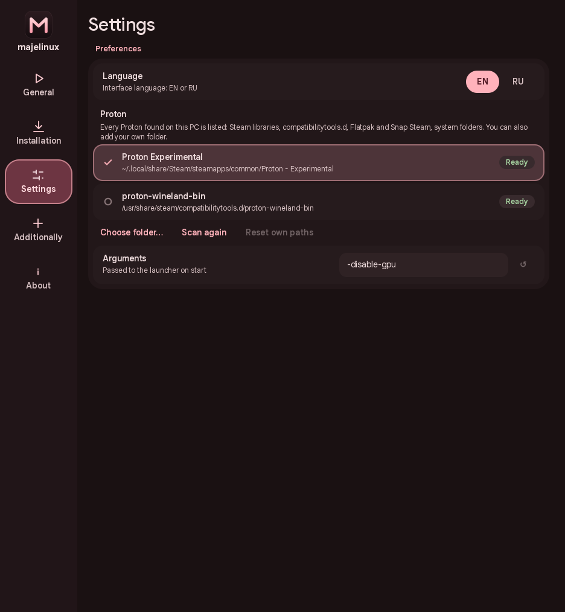
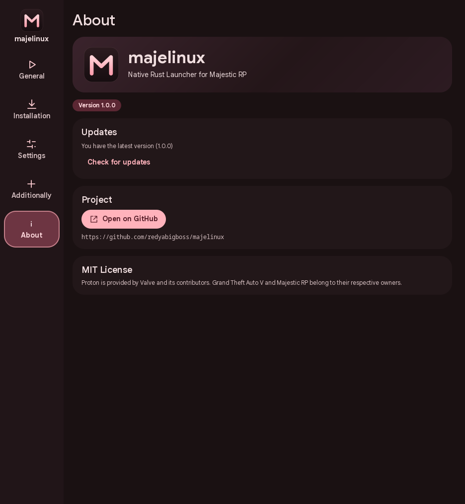

# majelinux

**Нативный лаунчер Majestic RP для Grand Theft Auto V на Linux.**

[English](README.md) · [Русский](README.ru.md)

[](LICENSE)
[](#требования)
[](https://www.rust-lang.org/)
[](https://github.com/redyabigboss/majelinux/commits/main)
[](https://github.com/redyabigboss/majelinux/releases)

---

## Содержание

- [О проекте](#о-проекте)
- [Скриншоты](#скриншоты)
- [Совместимость](#совместимость)
- [Обязательный параметр запуска в Steam](#обязательный-параметр-запуска-в-steam)
- [Требования](#требования)
- [Установка](#установка)
- [Использование](#использование)
- [Как это работает](#как-это-работает)
- [Решение проблем](#решение-проблем)
- [Частые вопросы](#частые-вопросы)
- [Участие в проекте](#участие-в-проекте)
- [Лицензия](#лицензия)
- [Отказ от ответственности](#отказ-от-ответственности)

## О проекте

majelinux — небольшой нативный интерфейс для Windows-лаунчера Majestic RP на Linux. Программа подготавливает Proton-префикс Grand Theft Auto V, устанавливает компоненты, нужные оригинальному лаунчеру, применяет точечную правку совместимости Wine к выбранной сборке Proton и запускает оригинальный `Majestic Launcher.exe` внутри того же окружения, которое Steam использует для GTA V.

Проект написан на Rust. Интерфейс GTK 3 вызывается напрямую через FFI. Сторонних Rust-зависимостей нет, программа собирается в один ELF-бинарник.

Что умеет лаунчер:

- Находит Proton в библиотеках Steam, `compatibilitytools.d`, Flatpak Steam, Snap Steam и системных каталогах; поддерживает добавление своих папок.
- Устанавливает в префикс GTA V оригинальный Majestic Launcher, PowerShell, обработчик `steam://`, шрифт эмодзи и исправление для русской раскладки.
- Применяет к выбранной сборке Proton совместимую правку `ntdll.so` только при наличии ожидаемой последовательности инструкций. Исходный файл предварительно сохраняется в резервную копию.
- Записывает сопоставление Proton для приложения `271590` в конфигурацию Steam, добавляет `PROTON_ENABLE_WAYLAND=0` в параметры запуска, если его там нет, и при необходимости запускает Steam.
- Запускает оригинальный лаунчер через `protontricks-launch` с корректным окружением совместимости Steam.
- Не переключает интерфейс на другую страницу при смене Proton.
- Поддерживает русский и английский язык, живой лог установки, окно отладки и проверку обновлений с контролем SHA-256.
- Умеет приостанавливать оригинальный Majestic Launcher после начала игры, снижая нагрузку на CPU и GPU без завершения Wine-сессии.

Файлы самой игры GTA V не изменяются.

## Скриншоты

<p align="center">
  
  
</p>

<p align="center">
  
</p>

<p align="center">
  
</p>

## Совместимость

> [!IMPORTANT]
> Официально поддерживается только **Steam-версия** Grand Theft Auto V **Legacy** с **Proton Experimental**. Другие конфигурации могут работать, но не проверялись и не входят в поддержку.

| Компонент | Статус | Примечание |
| --- | :---: | --- |
| Grand Theft Auto V — Steam, Legacy | ✅ Поддерживается | App ID `271590` |
| Grand Theft Auto V — Enhanced | ❌ Не поддерживается | Другой исполняемый файл и другие требования к совместимости |
| Grand Theft Auto V — Rockstar Games Launcher | ❌ Не поддерживается | Лаунчер рассчитан на префикс Steam |
| Grand Theft Auto V — Epic Games Store | ❌ Не поддерживается | Лаунчер рассчитан на префикс Steam |
| Proton Experimental | ✅ Поддерживается | Рекомендуемая и проверенная сборка |
| Другие версии Proton (стабильные ветки, GE-Proton, свои сборки) | ⚠️ Требуют проверки | Обнаружение работает, стабильность не гарантируется |
| Linux x86_64, сессия X11 или Wayland | ✅ Поддерживается | Windows-лаунчер работает через Proton |
| Windows, macOS | ❌ Не поддерживается | Только Linux |

Селектор Proton показывает и другие сборки, потому что пользователь может захотеть их проверить. Наличие сборки в списке не означает официальную поддержку.

## Обязательный параметр запуска в Steam

Укажите для Grand Theft Auto V такой параметр запуска:

```text
PROTON_ENABLE_WAYLAND=0 %command%
```

Как это сделать:

1. Откройте Steam.
2. Перейдите в **Библиотеку**.
3. Нажмите правой кнопкой на **Grand Theft Auto V** и выберите **Свойства**.
4. Откройте **Общие**.
5. Найдите **Параметры запуска**.
6. Вставьте `PROTON_ENABLE_WAYLAND=0 %command%` и закройте окно.

Если другие параметры уже заданы, сохраните их и поставьте переменную перед ними:

```text
PROTON_ENABLE_WAYLAND=0 DXVK_HUD=1 %command%
```

Без `PROTON_ENABLE_WAYLAND=0` драйвер Wayland в Wine/Proton может сделать оригинальный лаунчер нестабильным или помешать его запуску. majelinux также сам добавляет эту переменную в `localconfig.vdf`, если её там нет, и передаёт её в окружение кнопки **Play**, но параметр в Steam всё равно рекомендуется задавать вручную: его читают Steam и другие инструменты.

## Требования

| Требование | Подробности |
| --- | --- |
| ОС | Linux x86_64 |
| Рабочий стол | Сессия X11 или Wayland с GTK 3 |
| Steam | Нативная, Flatpak или Snap-версия |
| Игра | Steam-версия Grand Theft Auto V Legacy, установленная и хотя бы раз запущенная |
| Proton | Proton Experimental, установленный в Steam |
| Окружение | `protontricks`, GTK 3 |
| Сборка | `gcc` для шима русской раскладки |
| Загрузка | `curl` или `wget` |
| Необязательно | `xdg-open` для открытия папки логов |
| Для сборки из исходников | Rust 1.85 или новее (edition 2024), Cargo |

При первом нажатии **Play** или **Install** программа проверяет наличие `protontricks` и `gcc`. Если пакета нет, интерфейс показывает команду для `pacman`, `apt`, `dnf`, `zypper` или `xbps-install`. После установки пакетов установка продолжается автоматически.

## Установка

### Готовый бинарник

Скачайте последнюю версию и контрольные суммы:

```bash
curl -LO https://github.com/redyabigboss/majelinux/releases/latest/download/majelinux-linux-x86_64
curl -LO https://github.com/redyabigboss/majelinux/releases/latest/download/SHA256SUMS
sha256sum -c SHA256SUMS --ignore-missing
chmod +x majelinux-linux-x86_64
./majelinux-linux-x86_64
```

Чтобы добавить программу в `PATH`:

```bash
install -Dm755 majelinux-linux-x86_64 "$HOME/.local/bin/majelinux"
```

### Из исходников

Установите зависимости для своей системы. Для Arch Linux:

```bash
sudo pacman -S --needed rust gtk3 protontricks gcc curl
```

Для Debian или Ubuntu нужны заголовки GTK 3, `protontricks`, `gcc` и `curl`. Если системный Rust старше 1.85, установите его через [rustup](https://rustup.rs/).

Сборка и установка:

```bash
git clone https://github.com/redyabigboss/majelinux.git
cd majelinux
cargo build --release
./packaging/install.sh
```

`packaging/install.sh` устанавливает бинарник в `~/.local/bin/majelinux`, ярлык в `~/.local/share/applications/majelinux.desktop` и иконки в тему hicolor. Удалить эти файлы можно так:

```bash
./packaging/uninstall.sh
```

Скрипт удаления не трогает настройки, логи, резервные копии Proton и префикс GTA V.

### Первый запуск

1. Запустите Steam и убедитесь, что установлены Grand Theft Auto V Legacy и Proton Experimental.
2. Запустите majelinux из меню приложений или командой `majelinux`.
3. Откройте **Установка** и нажмите **Установить** либо нажмите **Играть** на главной странице. Если чего-то не хватает, **Играть** запустит установку автоматически.
4. В **Настройках** выберите нужную сборку Proton, если автоматический выбор не подходит.
5. После завершения установки нажмите **Играть**.

Для смены Proton нужно закрыть Steam. majelinux сам закрывает Steam, записывает сопоставление и запускает его снова.

## Использование

### Интерфейс

| Страница | Назначение |
| --- | --- |
| **Главная** | Запуск игры, текущий статус, открытие папки логов |
| **Установка** | Семь шагов установки, список пакетов и живой лог |
| **Настройки** | Язык интерфейса, выбор Proton, свои папки Proton, аргументы лаунчера |
| **Дополнительно** | Режим отладки с отдельным окном лога |
| **О программе** | Версия, ссылка на проект, лицензия и проверка обновлений |

### Шаги установки

| Шаг | Что делает |
| --- | --- |
| Патч Proton | Применяет совместимую правку `ntdll.so` к выбранной сборке Proton |
| Proton для GTA V | Записывает сопоставление Proton для приложения `271590` в Steam `config.vdf` |
| PowerShell в префиксе | Устанавливает PowerShell в префикс GTA V через `protontricks` |
| Лаунчер Majestic | Скачивает и запускает `MajesticLauncherSetup.exe` внутри префикса |
| Обработчик steam:// | Создаёт `C:\majestic\steam-run.bat` и регистрирует обработчик `steam://` |
| Шрифт эмодзи | Устанавливает переименованный Twemoji как `seguiemj.ttf` (необязательный шаг) |
| Фикс русской раскладки | Собирает `nolcall.so`, который убирает `LC_ALL=C` из окружения лаунчера |

### Аргументы лаунчера

Поле **Аргументы** передаётся в `Majestic Launcher.exe`. Значение по умолчанию:

```text
-disable-gpu
```

Кнопка сброса возвращает значение по умолчанию. Дополнительные аргументы для `protontricks-launch` задаются ключом `protontricks_args` в файле конфигурации.

### Очистка лаунчера

После того как GTA V проработает заданное время, majelinux может снизить нагрузку от оригинального Majestic Launcher. По умолчанию используется режим `suspend` через 60 секунд.

| Режим | Поведение |
| --- | --- |
| `suspend` | Отправляет `SIGSTOP` всем процессам Majestic Launcher, скрывает их окна и возобновляет работу, если игра возвращается. После выхода из игры лаунчер завершается через `SIGTERM`, а через две секунды — через `SIGKILL`. Это режим по умолчанию и самый безопасный. |
| `renderers` | Пока игра работает, периодически завершает процессы рендерера CEF у Majestic Launcher. |
| `all` | Завершает все процессы Majestic Launcher после задержки. Это может завершить Wine-сессию и разорвать соединение с игрой. После обнаруженного сбоя режим отключается защитным файлом. |
| `off` | Очистка не выполняется. |

Настройки хранятся в `~/.config/majelinux/config.ini`:

```ini
[General]
extra_args=-disable-gpu
proton=
language=en
debug=false
launcher_trim=suspend
launcher_trim_delay=60
protontricks_args=
```

`proton` пустой для автоматически выбранной сборки или содержит `path:/абсолютный/путь` для своей сборки. Строки `custom_proton` добавляют свои папки Proton.

### Командная строка

```text
majelinux --version
majelinux --trim-launcher <off|renderers|all|suspend> <задержка-в-секундах>
majelinux --wait-pid <pid>
```

`--trim-launcher` используется внутренним процессом очистки. `--wait-pid` нужен самообновлению, чтобы новый бинарник дождался завершения старого процесса.

### Переменные окружения

| Переменная | Действие |
| --- | --- |
| `MAJELINUX_NO_SELF_UPDATE` | Отключает встроенное обновление, если задано непустое значение, отличное от `0` |
| `XDG_CONFIG_HOME` | Меняет каталог конфигурации |
| `XDG_STATE_HOME` | Меняет каталог состояния и логов |
| `XDG_CACHE_HOME` | Меняет каталог кэша загрузок |

### Файлы и каталоги

| Путь | Содержимое |
| --- | --- |
| `~/.config/majelinux/config.ini` | Пользовательские настройки |
| `~/.local/state/majelinux/` | Состояние, файл блокировки, подготовка обновлений, резервные копии Proton |
| `~/.local/state/majelinux/logs/` | Логи установки, запуска, отладки и очистки |
| `~/.local/state/majelinux/proton-backup/` | Резервные копии изменённых `ntdll.so` |
| `~/.cache/majelinux/` | Скачанный установщик и шрифт эмодзи |
| `steamapps/compatdata/271590/pfx` | Proton-префикс GTA V |
| `steamapps/common/Grand Theft Auto V` | Каталог игры GTA V |

Переменные `XDG_CONFIG_HOME`, `XDG_STATE_HOME` и `XDG_CACHE_HOME` заменяют соответствующие префиксы `~/.config`, `~/.local/state` и `~/.cache`.

## Как это работает

### Поток запуска

1. Загружает настройки и при необходимости переносит старый каталог состояния.
2. Проверяет, что оригинальный лаунчер есть в префиксе GTA V.
3. Проверяет `protontricks` и `gcc` и ждёт установки недостающих пакетов.
4. Убеждается, что Steam запущен.
5. Подготавливает префикс GTA V для выбранной сборки Proton, если `config_info` не совпадает.
6. Добавляет `PROTON_ENABLE_WAYLAND=0` в параметры запуска Steam для приложения `271590`, если его там нет.
7. Применяет правку `ntdll.so`, если найдена точная совместимая последовательность.
8. Запускает ожидающее обновление Majestic Launcher, если оно лежит в префиксе.
9. Создаёт ссылку диска `S:` на библиотеку Steam.
10. Запускает лаунчер командой `protontricks-launch --appid 271590 <лаунчер> <аргументы>` с путями совместимости GTA V, путём клиента Steam и идентификаторами приложения.
11. После появления процесса игры запускает наблюдатель очистки лаунчера.
12. Следит за новыми процессами Wine в отладочном логе, дочитывает лог лаунчера и поддерживает отзывчивость интерфейса.

Оригинальный лаунчер не заменяется. majelinux запускает его в том же Proton-префиксе, который Steam использует для GTA V, поэтому игра, лаунчер и клиент Majestic RP работают в одном окружении Wine.

### Структура проекта

```text
majelinux/
├── Cargo.toml                  Пакет Rust и профиль релиза
├── Cargo.lock                  Зафиксированные зависимости (сторонних крейтов нет)
├── LICENSE                     Лицензия MIT
├── README.md                   Документация на английском
├── README.ru.md                Документация на русском
├── assets/
│   ├── icon.png                Иконка приложения
│   ├── icon.svg                Масштабируемая иконка
│   └── fonts/
│       ├── GoogleSans.ttf      Встроенный шрифт интерфейса
│       └── OFL.md              Лицензия шрифта
├── packaging/
│   ├── install.sh              Установка в домашний каталог
│   ├── uninstall.sh            Удаление
│   ├── release.sh              Сборка архива и контрольных сумм
│   └── majelinux.desktop       Ярлык рабочего стола
└── src/
    ├── main.rs                 Точка входа и разбор аргументов
    ├── ffi.rs                  Привязки GTK 3, GLib, GObject, Cairo и libc
    ├── i18n.rs                 Английские и русские строки
    ├── ui/
    │   ├── mod.rs              Окно, страницы, состояние, обработчики, обновления
    │   ├── widgets.rs          Помощники виджетов и символические иконки
    │   └── css.rs              Тема GTK CSS
    └── core/
        ├── diag.rs             Диагностика процессов Wine
        ├── font.rs             Переписывание таблицы имён TrueType
        ├── install.rs          Шаги установки в префикс
        ├── launch.rs           Оркестрация запуска
        ├── launchopts.rs       Запись параметров запуска Steam
        ├── log.rs              Буферизованный лог и дочитывание файлов
        ├── net.rs              Помощники загрузки
        ├── paths.rs            Пути XDG и Steam
        ├── process.rs          Процессы, сигналы и чтение /proc
        ├── proton.rs           Поиск Proton и правка ntdll
        ├── settings.rs         Настройки INI
        ├── sha256.rs           Реализация SHA-256
        ├── steam.rs            Поиск библиотек Steam
        ├── trim.rs             Наблюдатель очистки лаунчера
        ├── update.rs           Самообновление
        ├── util.rs             Разбор командной строки и мелкие помощники
        └── vdf.rs              Разбор и запись Valve Data Format
```

### Патч Proton

Патч меняет одну последовательность инструкций в `ntdll.so`. Она восстанавливает регистр Windows `RCX` при возврате из системного вызова, чего ожидает оригинальный лаунчер. majelinux:

- читает выбранную сборку Proton;
- считает вхождения точной последовательности;
- применяет патч только если она встречается ровно один раз;
- атомарно записывает результат;
- проверяет изменённый файл;
- сохраняет исходный `ntdll.so` в каталог состояния.

Сборки, в которых Wine уже восстанавливает `RCX`, используются без изменений. Сборки без ожидаемой последовательности тоже используются как есть. Каталог Proton только для чтения не изменяется. Файлы игры не затрагиваются.

### Самообновление

При запуске majelinux запрашивает у API GitHub Releases последний релиз `redyabigboss/majelinux`. Если версия новее, обновление:

1. скачивает `SHA256SUMS` и `majelinux-linux-x86_64`;
2. проверяет контрольную сумму SHA-256;
3. проверяет, что файл является ELF-бинарником и запускается с `--version`;
4. копирует его рядом с текущим исполняемым файлом, сохраняет предыдущий бинарник в каталог состояния и атомарно заменяет программу;
5. запускает новый бинарник с `--wait-pid <старый-pid>` и завершается.

Для установок из пакетных менеджеров в `/usr`, `/nix/store` или `/app` самообновление отключено: такую программу нужно обновлять пакетным менеджером.

### Логи

Каждый запуск создаёт лог с меткой времени в `~/.local/state/majelinux/logs/`. Страницы **Установка** и **Отладка** показывают лог в реальном времени. Старые логи очищаются при старте. Очистка лаунчера пишет свои решения в `trim.log`.

## Решение проблем

| Проблема | Решение |
| --- | --- |
| `No graphical session found` | Запускайте majelinux в графической сессии с корректным `DISPLAY` или `WAYLAND_DISPLAY`. |
| `majelinux is already running` | Закройте другой экземпляр. Блокировка снимается автоматически при завершении процесса. |
| `GTA V not found` | Установите Steam-версию Legacy и запустите игру один раз из Steam. |
| `Prefix 271590 not found` | Запустите GTA V один раз из Steam, чтобы создался Proton-префикс. |
| `Launcher not found in the prefix` | Снова откройте **Установку** и выполните шаг **Лаунчер Majestic**. |
| `Steam did not close` | Закройте Steam вручную и нажмите **Играть** ещё раз. Сопоставление Proton записывается только при закрытом Steam. |
| `Pattern found N times ... nothing was changed` | Выбранная сборка Proton несовместима с патчем. Используйте Proton Experimental. |
| `The release has no checksum for this build` | Релиз неполный или вместо файла пришла HTML-страница. Повторите позже. |
| `The downloaded file does not match its checksum` | Удалите `~/.local/state/majelinux/update/` и попробуйте снова. |
| `majelinux is installed by a package manager` | Обновляйте программу через пакетный менеджер, а не встроенным обновлением. |
| Лаунчер или игра падают при запуске | Задайте `PROTON_ENABLE_WAYLAND=0 %command%`, выберите Proton Experimental и посмотрите последний лог. |
| После **Играть** нет окна игры | Проверьте лог запуска, убедитесь, что оригинальный лаунчер установлен, и завершён ли шаг обработчика `steam://`. |
| В лаунчере нет эмодзи | Шаг с эмодзи необязательный; повторите его на странице **Установка**. |
| Лаунчер остаётся на экране во время игры | Проверьте `~/.local/state/majelinux/logs/trim.log`; задержка по умолчанию — 60 секунд, режим — `suspend`. |
| Проверка обновлений не работает при старте | Автоматическая проверка завершается молча; откройте **О программе** и запустите проверку вручную, чтобы увидеть ошибку. |

Подробный лог включает **Режим отладки** на странице **Дополнительно**. Окно отладки показывает полный вывод и останавливает префикс при закрытии.

## Частые вопросы

**majelinux изменяет GTA V?**
Нет. Программа работает с Proton-префиксом, выбранной сборкой Proton, настройками Steam и оригинальным Majestic Launcher. Файлы игры не изменяются.

**Работает ли это с GTA V Enhanced?**
Нет. Поддерживается только Legacy-версия.

**Работает ли это с версией из Rockstar Games Launcher или Epic Games Store?**
Нет. Лаунчер рассчитан на префикс Steam и App ID `271590`.

**Программа скачивает GTA V?**
Нет. Игра должна быть куплена и установлена в Steam.

**Можно ли использовать GE-Proton или другую сборку?**
Селектор умеет находить и пробовать другие сборки, но официально поддерживается только Proton Experimental. Остальные сборки считайте экспериментальными.

**Почему при смене Proton закрывается Steam?**
Steam держит `config.vdf` открытым и может перезаписать изменения. majelinux закрывает Steam, записывает сопоставление, проверяет его и запускает Steam снова.

**Почему оригинальный лаунчер приостанавливается, а не закрывается?**
Закрытие лаунчера может разрушить Wine-сессию и разорвать соединение с игрой. Приостановка останавливает работу CPU и GPU, сохраняя сессию. После выхода из игры лаунчер завершается, и ресурсы освобождаются.

**Есть ли режим только командной строки?**
Нет. Программе нужна графическая сессия. Аргументы командной строки ограничены выводом версии и внутренними служебными режимами.

**Как удалить программу?**
Запустите `./packaging/uninstall.sh`, затем удалите `~/.config/majelinux`, `~/.local/state/majelinux` и `~/.cache/majelinux`, если нужно стереть настройки, логи и кэш загрузок.

## Участие в проекте

Issues и pull requests приветствуются. Перед отправкой изменений выполните:

```bash
cargo fmt --check
cargo test --release
cargo build --release
```

Не добавляйте сторонние Rust-крейты, сохраняйте работу интерфейса GTK 3 в X11 и Wayland и не добавляйте код, изменяющий файлы игры GTA V. В pull request укажите проверенную сборку Proton и дистрибутив.

Проект поддерживает [@redyabigboss](https://github.com/redyabigboss).

## Лицензия

[MIT](LICENSE) © 2026 Qustsu

Встроенный шрифт Google Sans распространяется по лицензии SIL Open Font License; см. [`assets/fonts/OFL.md`](assets/fonts/OFL.md). Шрифт эмодзи, скачиваемый при работе, основан на Twemoji (CC-BY 4.0) и Mozilla `twemoji-colr` (Apache License 2.0).

## Отказ от ответственности

majelinux — неофициальный общественный проект. Он не связан с Rockstar Games, Take-Two Interactive, Valve Corporation, Majestic RP и разработчиками Majestic Launcher. Grand Theft Auto V, Rockstar Games, Take-Two, Steam, Proton и Majestic RP являются товарными знаками соответствующих владельцев. Для использования нужна легально купленная копия Grand Theft Auto V.

Используйте программу на свой риск. Авторы не несут ответственности за блокировки, потерю данных, ограничения аккаунта или ущерб, вызванный сторонним программным обеспечением или правилами сервера.
